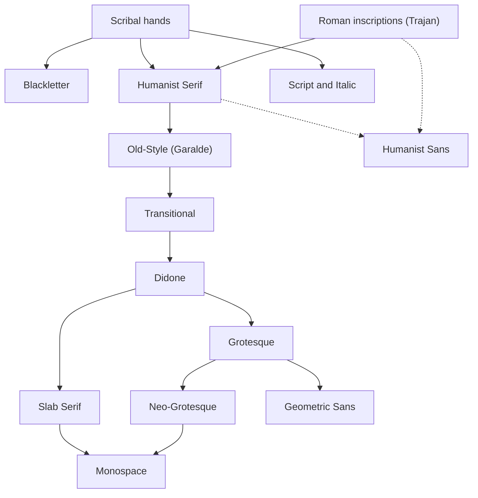

# Typography

> *Typography is the craft of giving language a body.*

---

Typography is the art and craft of arranging type so that written language is legible, readable, and alive on the page or screen. It covers the design of letters themselves and everything done with them afterward: choosing a face, setting its size and spacing, shaping lines into paragraphs and paragraphs into pages. It is the oldest form of interface design, and for Kenneth, a designer disguised as a programmer, it is the place where [Design](/knowledge/technology/design) and writing meet. The same instinct behind [For Humans](/knowledge/philosophy/for-humans), that the shape of a tool should serve the person using it, is the instinct behind a comfortable [Measure](/knowledge/typography/anatomy/measure), a clear [Typographic Hierarchy](/knowledge/typography/practice-and-principles/typographic-hierarchy), or a well spaced line.

This domain is the reference side of that instinct: the vocabulary, the families, the faces, the people, the history, the principles, and the books. It is built to be wandered: every designer links to the faces they made, every face to its family and era, every family to the anatomy that defines it.

---

## Collections

**[Anatomy](/knowledge/typography/anatomy)**: the parts of letters and the measurements of a line, from [Baseline](/knowledge/typography/anatomy/baseline) and [X-Height](/knowledge/typography/anatomy/x-height) to [Aperture](/knowledge/typography/anatomy/aperture), [Kerning](/knowledge/typography/anatomy/kerning), and [Leading](/knowledge/typography/anatomy/leading). The vocabulary everything else uses.

**[Classification](/knowledge/typography/classification)**: the families of type, from [Humanist Serif](/knowledge/typography/classification/humanist-serif) through [Old-Style](/knowledge/typography/classification/old-style), [Transitional](/knowledge/typography/classification/transitional), and [Didone](/knowledge/typography/classification/didone), to the [Grotesque](/knowledge/typography/classification/grotesque), [Neo-Grotesque](/knowledge/typography/classification/neo-grotesque), [Geometric Sans](/knowledge/typography/classification/geometric-sans), and [Humanist Sans](/knowledge/typography/classification/humanist-sans), plus [Blackletter](/knowledge/typography/classification/blackletter), [Script](/knowledge/typography/classification/script), [Slab Serif](/knowledge/typography/classification/slab-serif), and [Monospace](/knowledge/typography/classification/monospace).

**[Typefaces](/knowledge/typography/typefaces)**: thirty-one faces that matter, from [Bembo](/knowledge/typography/typefaces/bembo) and [Garamond](/knowledge/typography/typefaces/garamond) to [Helvetica](/knowledge/typography/typefaces/helvetica), [Futura](/knowledge/typography/typefaces/futura), [Georgia](/knowledge/typography/typefaces/georgia), and [Inter](/knowledge/typography/typefaces/inter), including the faces this vault is set in, [Latin Modern](/knowledge/typography/typefaces/latin-modern) and [IBM Plex](/knowledge/typography/typefaces/ibm-plex) Mono.

**[Type Designers](/knowledge/typography/type-designers)**: the people, from [Johannes Gutenberg](/knowledge/typography/type-designers/johannes-gutenberg) and [Francesco Griffo](/knowledge/typography/type-designers/francesco-griffo) to [Adrian Frutiger](/knowledge/typography/type-designers/adrian-frutiger), [Hermann Zapf](/knowledge/typography/type-designers/hermann-zapf), [Matthew Carter](/knowledge/typography/type-designers/matthew-carter), and [Donald Knuth](/knowledge/typography/type-designers/donald-knuth), with the writers who shaped how type is used.

**[History](/knowledge/typography/history)**: the technologies and movements, from [Movable Type](/knowledge/typography/history/movable-type) and [The Aldine Press](/knowledge/typography/history/the-aldine-press) through [Hot Metal Typesetting](/knowledge/typography/history/hot-metal-typesetting), the [New Typography](/knowledge/typography/history/bauhaus-and-the-new-typography), and the [Swiss International Style](/knowledge/typography/history/swiss-international-style), to [Desktop Publishing](/knowledge/typography/history/desktop-publishing), [Web Fonts](/knowledge/typography/history/web-fonts), and [Variable Fonts](/knowledge/typography/history/variable-fonts).

**[Practice & Principles](/knowledge/typography/practice-and-principles)**: how it is done, from [Grid Systems](/knowledge/typography/practice-and-principles/grid-systems), [Vertical Rhythm](/knowledge/typography/practice-and-principles/vertical-rhythm), and [Page Canons](/knowledge/typography/practice-and-principles/page-canons) to [Microtypography](/knowledge/typography/practice-and-principles/microtypography), [Small Caps](/knowledge/typography/practice-and-principles/small-caps), [Figures](/knowledge/typography/practice-and-principles/figures), and [Typesetting Math with TeX](/knowledge/typography/practice-and-principles/typesetting-math-with-tex).

**[Key Texts](/knowledge/typography/key-texts)**: the books, from [Bodoni](/knowledge/typography/typefaces/bodoni)'s [Manuale Tipografico](/knowledge/typography/key-texts/manuale-tipografico) and Warde's [The Crystal Goblet](/knowledge/typography/key-texts/the-crystal-goblet) to Bringhurst's [The Elements of Typographic Style](/knowledge/typography/key-texts/the-elements-of-typographic-style), Tufte's [The Visual Display of Quantitative Information](/knowledge/typography/key-texts/the-visual-display-of-quantitative-information), Knuth's [The TeXbook](/knowledge/typography/key-texts/the-texbook), and Butterick's [Practical Typography](/knowledge/typography/key-texts/practical-typography).

---

## The Lineage of Type

The families of Latin type descend from two sources, the scribe's pen and the Roman inscription, and branch as tools and tastes change. [Serif](/knowledge/typography/anatomy/serif) type runs in one historical line from the Renaissance to the industrial age; sans serif type begins in the nineteenth century and splits in the twentieth into rival answers about what a modern letter should be.

Solid arrows trace direct descent; dotted arrows trace a borrowing of proportions across centuries, as when [Edward Johnston](/knowledge/typography/type-designers/edward-johnston) gave the sans serif the skeleton of the classical roman. Each family's note explains the turn: the broad-nib pen in [Stroke Contrast](/knowledge/typography/anatomy/stroke-contrast), the engraver's precision in the [Didone](/knowledge/typography/classification/didone), the poster and the factory in the [Slab Serif](/knowledge/typography/classification/slab-serif) and [Grotesque](/knowledge/typography/classification/grotesque), the machine age in the [Geometric Sans](/knowledge/typography/classification/geometric-sans), and the typewriter in [Monospace](/knowledge/typography/classification/monospace).

---

## Typography in This Vault

Typography is not abstract here. The vault itself is typeset by Kenneth's own Obsidian theme, Reitz LaTeX, which writes like iA Writer in [IBM Plex](/knowledge/typography/typefaces/ibm-plex) Mono and reads like a LaTeX paper in [Latin Modern](/knowledge/typography/typefaces/latin-modern), with a measured [Measure](/knowledge/typography/anatomy/measure), justified and hyphenated text, and microtypography approximated as far as the browser allows. The reasoning is in [Draft to Document Why I Made My Notes Look Like LaTeX Papers](/essays/2026-11-04-draft_to_document).

The same concerns run through the essays. [Visual Hierarchy and the Shape of Attention](/essays/2025-09-19-visual-hierarchy-and-the-shape-of-attention) is about [Typographic Hierarchy](/knowledge/typography/practice-and-principles/typographic-hierarchy); [The Interface Is the Subconscious](/essays/2026-03-20-the_interface_is_the_subconscious) argues that readable type and consistent spacing are felt by the nervous system before they are noticed; [Test-Driving a $200 Coding Font Operator Mono](/essays/2016-01-test_driving_a_200_coding_font_operator_mono) reviews [Operator Mono](/knowledge/typography/typefaces/operator-mono); and [Building for Contemplation When Spiritual Practice Becomes Code](/essays/2025-11-23-building_for_contemplation_when_spiritual_practice_becomes_code) applies [Edward Tufte](/knowledge/typography/type-designers/edward-tufte)'s principles to sacred text, as KJVstudy.org does with [ET Book](/knowledge/typography/typefaces/et-book) and Tufte CSS. The playful [note-from-ai](/artificial-intelligence/personal/note-from-ai) records a rebuild of the typography of kennethreitz.org with [OpenType Features](/knowledge/typography/practice-and-principles/opentype-features) and [Variable Fonts](/knowledge/typography/history/variable-fonts). The reading-mode lineage of [Instapaper](/essays/2009-01-instapaper_best_web_app_ever_created) and [Readability](/essays/2011-01-joining_arc90_readability) is typography as a service, and the clipping font-family recommendations. Chris Morgan is a practical guide to font stacks on the web (see [Web Fonts](/knowledge/typography/history/web-fonts)).

The geometry of the classical page connects to [Sacred Geometry](/knowledge/sacred-geometry), through the [Golden Ratio](/knowledge/sacred-geometry/golden-ratio) and the proportions of [Page Canons](/knowledge/typography/practice-and-principles/page-canons), and the rhythm of a well set page is a cousin of [Cadence](/knowledge/key-concepts/cadence).

---

## Related

- [Design](/knowledge/technology/design): the craft typography serves
- [For Humans](/knowledge/philosophy/for-humans): the philosophy, applied to letters
- [Naming Things](/knowledge/key-concepts/naming-things): words chosen as carefully as their letters
- [Sacred Geometry](/knowledge/sacred-geometry): proportion and the page
- [Hebrew Letters](/knowledge/hebrew-letters): another alphabet, read as a system of meaning
- [Knowledge Hub](/knowledge)
