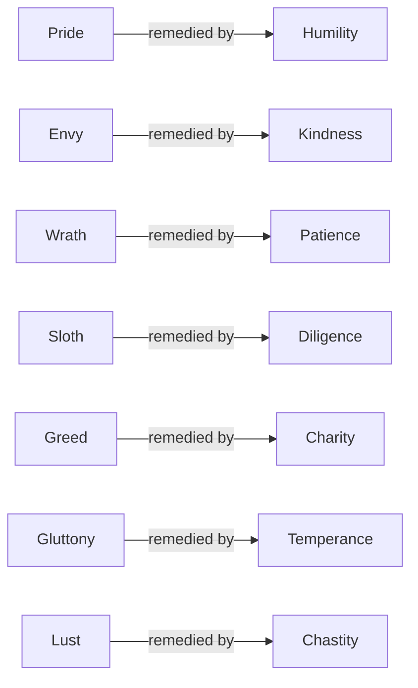

# Virtues & Vices

> *Every vice is a virtue that forgot what it was for.*

---

This domain maps the old moral psychology of the West — the seven deadly sins and the virtues that answer them — not as a courtroom but as a diagnostic manual. The desert monks who first catalogued the sins were not compiling a list of crimes; they were describing the recurring *thoughts* that colonize a mind, the disordered desires underneath behavior. Read that way, the tradition is shadow work a millennium and a half before Jung gave it a name: what we refuse to look at in ourselves does not disappear, it runs us — which is precisely what The Shadow describes, and precisely what the monks meant.

The lineage runs from Evagrius Ponticus's eight *logismoi* in the Egyptian desert, through Gregory the Great's consolidation into seven, to Dante's Purgatorio, which arranges the whole mountain as a therapy of love — every sin a love that is perverted, deficient, or excessive. The remedial virtues are the counter-practices; the cardinal and theological virtues frame the larger architecture the sins deform.

The vault tie-in that makes this more than a history lesson: the [Enneagram](/knowledge/enneagram)'s nine passions are the seven deadly sins plus two. Each type carries one of the old sins as its core passion, with fear (Type 6) and deceit (Type 3) rounding out the nine. The Christian moral tradition — see [Christianity](/knowledge/religions-of-the-world/christianity) and [Catholic Saints & Figures](/knowledge/spirituality/catholicism/catholic-saints-and-figures) — and a modern typology turn out to be reading the same map.

---

## The Master Table

| Sin | Enneagram Passion | Remedial Virtue |
|-----|-------------------|-----------------|
| [Pride](/knowledge/virtues-and-vices/seven-deadly-sins/pride) | [Type 2](/knowledge/enneagram/type-2-the-helper) | [Humility](/knowledge/virtues-and-vices/virtues/humility) |
| [Envy](/knowledge/virtues-and-vices/seven-deadly-sins/envy) | [Type 4](/knowledge/enneagram/type-4-the-individualist) | [Kindness](/knowledge/virtues-and-vices/virtues/kindness) |
| [Wrath](/knowledge/virtues-and-vices/seven-deadly-sins/wrath) | [Type 1](/knowledge/enneagram/type-1-the-reformer) | [Patience](/knowledge/virtues-and-vices/virtues/patience) |
| [Sloth](/knowledge/virtues-and-vices/seven-deadly-sins/sloth) | [Type 9](/knowledge/enneagram/type-9-the-peacemaker) | [Diligence](/knowledge/virtues-and-vices/virtues/diligence) |
| [Greed](/knowledge/virtues-and-vices/seven-deadly-sins/greed) | [Type 5](/knowledge/enneagram/type-5-the-investigator) | [Charity](/knowledge/virtues-and-vices/virtues/charity) |
| [Gluttony](/knowledge/virtues-and-vices/seven-deadly-sins/gluttony) | [Type 7](/knowledge/enneagram/type-7-the-enthusiast) | [Temperance](/knowledge/virtues-and-vices/virtues/temperance-virtue) |
| [Lust](/knowledge/virtues-and-vices/seven-deadly-sins/lust) | [Type 8](/knowledge/enneagram/type-8-the-challenger) | [Chastity](/knowledge/virtues-and-vices/virtues/chastity-virtue) |

Each sin is answered by the virtue trained to hold against it:

Two passions fall outside the seven: **fear** belongs to [Type 6](/knowledge/enneagram/type-6-the-loyalist) and **deceit** to [Type 3](/knowledge/enneagram/type-3-the-achiever) — the Enneagram's additions to the desert's catalogue.

---

## The Folders

**[Seven Deadly Sins](/knowledge/virtues-and-vices/seven-deadly-sins)** — the seven, each traced from Evagrius through Gregory to Dante's mountain, with its remedy and its Enneagram passion.

**[Virtues](/knowledge/virtues-and-vices/virtues)** — the seven heavenly remedies, the four cardinal virtues of Plato and Aquinas, and the three theological virtues of 1 Corinthians 13.

---

## Related

- The Shadow — the modern name for what the monks were mapping
- [Christianity](/knowledge/religions-of-the-world/christianity) — the tradition that carried the catalogue
- [Enneagram](/knowledge/enneagram) — nine passions, seven of them the old sins
- [Catholic Saints & Figures](/knowledge/spirituality/catholicism/catholic-saints-and-figures) — the lives that embodied the remedies
- [Knowledge Hub](/knowledge)

---

*The sins are not what we did. They are what we wanted, bent out of shape.*
