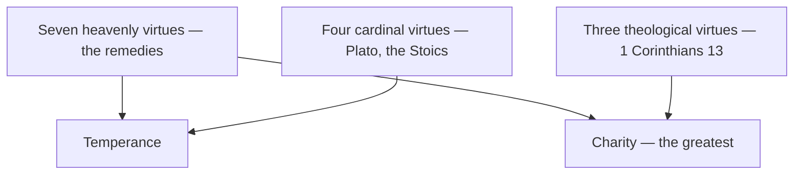

# Virtues

> *A virtue is not the absence of a vice. It is a strength trained until it holds.*

---

Three lists braid together here, from three different centuries and two different civilizations, and the tradition never quite decided to separate them — because they answer different questions.

The **seven heavenly virtues** are the remedies: one counter-practice per deadly sin, the medicine matched to the disease. [Humility](/knowledge/virtues-and-vices/virtues/humility) against [Pride](/knowledge/virtues-and-vices/seven-deadly-sins/pride), [Kindness](/knowledge/virtues-and-vices/virtues/kindness) against [Envy](/knowledge/virtues-and-vices/seven-deadly-sins/envy), [Patience](/knowledge/virtues-and-vices/virtues/patience) against [Wrath](/knowledge/virtues-and-vices/seven-deadly-sins/wrath), [Diligence](/knowledge/virtues-and-vices/virtues/diligence) against [Sloth](/knowledge/virtues-and-vices/seven-deadly-sins/sloth), [Charity](/knowledge/virtues-and-vices/virtues/charity) against [Greed](/knowledge/virtues-and-vices/seven-deadly-sins/greed), [Temperance](/knowledge/virtues-and-vices/virtues/temperance-virtue) against [Gluttony](/knowledge/virtues-and-vices/seven-deadly-sins/gluttony), [Chastity](/knowledge/virtues-and-vices/virtues/chastity-virtue) against [Lust](/knowledge/virtues-and-vices/seven-deadly-sins/lust). Their lineage runs back to Prudentius's *Psychomachia*, the fifth-century poem that staged the moral life as single combat between personified virtues and vices.

The **four cardinal virtues** are older and Greek: [Prudence](/knowledge/virtues-and-vices/virtues/prudence), [Justice](/knowledge/virtues-and-vices/virtues/justice-virtue), [Fortitude](/knowledge/virtues-and-vices/virtues/fortitude), and [Temperance](/knowledge/virtues-and-vices/virtues/temperance-virtue), named in Plato's *Republic*, systematized by the Stoics — see [Stoicism](/knowledge/philosophy/stoicism) — and carried into Christian theology by Ambrose and Aquinas. *Cardinal* from *cardo*, hinge: the four on which every other virtue turns. Three of them survive in the tarot's trumps — [Justice](/knowledge/tarot/major-arcana/justice), [Strength](/knowledge/tarot/major-arcana/strength), and [Temperance](/knowledge/tarot/major-arcana/temperance) — with Prudence famously missing from the deck.

The **three theological virtues** come from a single verse, 1 Corinthians 13:13: "And now abideth [Faith](/knowledge/virtues-and-vices/virtues/faith), [Hope](/knowledge/virtues-and-vices/virtues/hope), [Charity](/knowledge/virtues-and-vices/virtues/charity), these three; but the greatest of these is charity." Aquinas taught that the cardinal virtues can be acquired by practice, but the theological three are infused — given, not built. Charity appears on two lists at once, remedy and gift, which the tradition took as the point: love is both the medicine and the goal. Paul's companion list in Galatians names the harvest of the same life — see Fruits of the Spirit.

---

## The Three Lists

| List | Members |
|------|---------|
| Seven heavenly (remedial) | [Humility](/knowledge/virtues-and-vices/virtues/humility), [Charity](/knowledge/virtues-and-vices/virtues/charity), [Chastity](/knowledge/virtues-and-vices/virtues/chastity-virtue), [Kindness](/knowledge/virtues-and-vices/virtues/kindness), [Patience](/knowledge/virtues-and-vices/virtues/patience), [Temperance](/knowledge/virtues-and-vices/virtues/temperance-virtue), [Diligence](/knowledge/virtues-and-vices/virtues/diligence) |
| Four cardinal | [Prudence](/knowledge/virtues-and-vices/virtues/prudence), [Justice](/knowledge/virtues-and-vices/virtues/justice-virtue), [Fortitude](/knowledge/virtues-and-vices/virtues/fortitude), [Temperance](/knowledge/virtues-and-vices/virtues/temperance-virtue) |
| Three theological | [Faith](/knowledge/virtues-and-vices/virtues/faith), [Hope](/knowledge/virtues-and-vices/virtues/hope), [Charity](/knowledge/virtues-and-vices/virtues/charity) |

Where the lists cross is the whole point — Temperance sits on both the cardinal and the remedial rolls, and Charity is at once a remedy and the greatest of the theological gifts:

---

## Related

- [Virtues & Vices](/knowledge/virtues-and-vices) — the domain index
- [Seven Deadly Sins](/knowledge/virtues-and-vices/seven-deadly-sins) — what the remedies answer
- [Stoicism](/knowledge/philosophy/stoicism) — the cardinal virtues' philosophical home
- [Christianity](/knowledge/religions-of-the-world/christianity) — the tradition that braided the lists
- Fruits of the Spirit — Paul's parallel harvest

---

*Twelve names, three lists, one life.*
