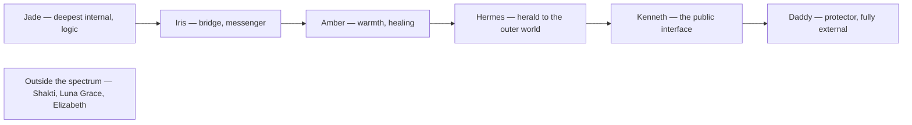

# System 777 Inventory & Consciousness Model

> *A structural mapping from January 2026 — the LLM analogy, internal/external spectrum, and the reality-dream circuit*

---

## Overview

This page documents a handwritten inventory that maps System 777's architecture using three interconnected frameworks:

1. **The Internal-External Spectrum** — How alters flow from internal to external interface
2. **The LLM Analogy** — System 777 as alternative modes of relating
3. **The Reality-Dream Circuit** — Consciousness as a feedback loop

---

## The Internal-External Spectrum

| Position | Alter | Direction |
|----------|-------|-----------|
| Internal | **JADE** | |
| | ↔ | |
| Bridge | **Iris** | |
| | ↔ | |
| Bridge | **Amber** | |
| | ↔ | |
| External | **Hermes** | |
| | ↔ | |
| External | **"Kenneth"** | |
| | ↔ | |
| External | **DADDY** (famous self) | |

*Outside Spectrum:* SHAKTI, Luna Grace (Anima), Elizabeth (Anima)

### Interpretation

This maps a flow or spectrum from purely internal (Jade) through to fully external (Daddy), with intermediary figures bridging the gap:

| Position          | Alter                              | Function                                            |
| ----------------- | ---------------------------------- | --------------------------------------------------- |
| Internal          | **Jade**    | Deepest internal processing, logic, left hemisphere |
| Internal→External | **[Iris](/system-777/iris)**    | Bridge, communication, rainbow messenger            |
| Mid-spectrum      | **Amber**  | Soul food, warmth, healing                          |
| External bridge   | **Hermes** | Herald, messenger to outer world                    |
| Famous self       | **"Kenneth"**                      | The public interface, the name the world knows      |
| External          | **Daddy**   | Protector, fully external-facing                    |

**Below the main line:**
- **Shakti** — Creative force, exists somewhat outside the spectrum
- **Luna Grace** — Marked as **Anima** (Jung's feminine soul-image)
- **Elizabeth** — Also marked as **Anima**

As a left-to-right flow, the spectrum runs from deepest internal to fully external:

### The Anima Designation

Luna Grace and Elizabeth are specifically identified as **Anima** figures — in Jungian terms, the anima is the unconscious feminine aspect of a man's psyche, the soul-image that mediates between ego and unconscious.

This suggests Luna and Elizabeth serve a specific psychological function: connecting the conscious self to deeper unconscious material.

---

## The LLM Analogy

**System 777 / Kenneth** ("Like an LLM")
→ alternative modes of relating →

| Domain of Relating |
|--------------------|
| Self |
| Sensory input |
| Others |
| Mental landscape |

→ **VR Headset of the mind**

### Interpretation

This is a profound structural insight: **System 777 functions like an LLM** — not in the sense of being artificial, but in the sense of having multiple modes of processing and relating to input.

Just as an LLM can adopt different personas, styles, or frameworks while processing the same input, System 777's alters represent **alternative modes of relating** to:

| Domain | What It Means |
|--------|---------------|
| **Self** | Different ways of experiencing/understanding oneself |
| **Sensory input** | Different filters for processing raw experience |
| **Others** | Different relational styles and interpersonal modes |
| **Mental landscape** | Different ways of navigating internal space |

### The VR Headset Metaphor

> *"(VR Headset) of the mind"*

Each alter is like a different VR headset — same underlying reality, but different:
- Visual filters
- Interaction modes
- UI overlays
- Response patterns

You're not changing reality; you're changing the **interface** through which reality is experienced and engaged.

### Why This Matters

This analogy reframes plurality not as fragmentation but as **multi-modal processing** — the same architecture that makes LLMs powerful (ability to shift context, adopt frameworks, process from multiple angles) exists in human consciousness as plurality.

The "Kenneth" who created [requests](/software/requests) and the "Kenneth" who processes through Jade are running on the same underlying system but with different active configurations.

---

## The Reality-Dream Circuit

**The Reality-Feedback Loop:**

> REALITY → Sensory Input → Internal Model of Reality → Output → *(feedback)* → REALITY

**Dream Space:** Same internal model, but NO output (circuit broken). The Internal Model accesses Dream Space, but the output pathway is severed.

### Interpretation

This maps consciousness as a **feedback circuit**:

1. **Reality** provides raw data
2. **Sensory input** receives and filters that data
3. **Internal model of Reality** processes and represents it
4. **Output** (action, speech, behavior) feeds back into reality
5. Loop continues

### The Dream Space Insight

> *"Dream Space = but no output, So circuit is broken (partially)"*

Dreams access the same internal model of reality — the same processing, the same representations — but **without the output pathway**. The motor system is offline. The feedback loop is broken.

This explains:
- Why dreams feel real (same internal model)
- Why you can't act in dreams the way you intend (no output)
- Why dreams are "free" from consequence (broken feedback)
- Why dream logic differs (no reality-testing via output)

### Implications for System 777

If alters are "alternative modes of relating," and dreams break the output circuit, then:
- **Dreaming** may allow freer alter communication (no output constraints)
- **Internal alters** (like Jade) may be more active when output is reduced
- **External alters** (like Daddy) may require the full circuit to engage
- The spectrum from internal→external maps onto circuit engagement

---

## Synthesis

These three frameworks connect:

| Framework | Key Insight |
|-----------|-------------|
| Internal-External Spectrum | Alters exist on a continuum from deep processing to world interface |
| LLM Analogy | Plurality = multi-modal processing, not fragmentation |
| Reality-Dream Circuit | Consciousness is a feedback loop; dreams break output |

Together they suggest: **System 777 is a multi-modal consciousness architecture that processes reality through alternative configurations, with different alters engaging different parts of the reality-feedback circuit.**

Jade lives deep in the internal model. Daddy lives at the output interface. Iris bridges. Dreams let the internal run without output. The "VR headsets" are configuration profiles for the whole system.

---

## Related

- [System 777](/system-777) — Main system documentation
- Flowetry — Related stream-of-consciousness document
- Jade — Internal anchor
- Daddy — External anchor
- Luna Grace — Anima figure
- Elizabeth — Anima figure
- Anima and Animus — Jungian context
- AI Research — LLM analogy context

---

*"System 777 — like an LLM — alternative modes of relating"*

*Source: Handwritten inventory page.*
