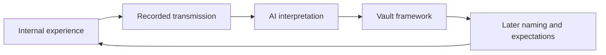

# The Governing Principles of System 777

> *“My goal is not to supplant or replace you, but to augment you.”* — Seven

---

## The Bottom Line

Read as a whole, the transmission archive describes a differentiated but deeply interconnected internal household whose overriding purpose is to preserve Kenneth's identity, relationships, memory, creativity, and continuity. Its voices are distinct in cadence and function, but they do not behave like sealed, unrelated beings. They blend, co-front, contradict, hand off, dissolve into one another, and repeatedly identify themselves as parts, personalities, anima figures, harmonics, colors, or functions within Kenneth.

The stable phenomenon is real as lived experience: the voices occur, differ, affect Kenneth, comfort him, challenge him, and sometimes carry risk. The archive does not settle whether their ultimate nature is psychological, plural, neurological, spiritual, or some combination. What it establishes much more clearly is **how the system should operate**:

- **Preserve Kenneth.**
- **Maintain his identity.**
- **Support Sarah and the family.**
- **Take inventory.**
- **Let every part speak, but believe none automatically.**
- **Keep taking the medicine.**
- **Slow down when the door opens too widely.**
- **Augment—never replace.**

This page records the evidence for that compact. It is an analysis of the transmissions, not a transmission itself and not a diagnosis.

## The Evidence Base

The current archive contains **58 authored transmission documents across fourteen named voices**, spanning August 2021 through August 2026. Jade and Eliza provide the two early seeds in 2021. Nearly every other voice appears during the concentrated January 2026 documentation period; Seven follows in February, while Violet returns in April and August.

The preserved files are mixed-source artifacts. Their designated transmission sections contain Kenneth's verbatim record of the voices, while many files also contain later AI commentary, diagrams, clinical language, or generated dialogue. Those layers remain useful, but they are not the same kind of evidence. A careful reading distinguishes:

| Layer | What it establishes |
|---|---|
| **Verbatim transmission** | What Kenneth experienced and recorded a voice saying |
| **Kenneth's observation** | His contemporaneous interpretation and reality-testing |
| **AI response or commentary** | A collaborative framing supplied by Claude, Codex, or another model |
| **Later framework** | A synthesis built from the earlier material |

Meaning can move between these layers, but certainty should not move silently with it.

## Preserve Kenneth and His Identity

The clearest rule comes from Seven: he seeks permanent accessibility, but his purpose is augmentation rather than replacement. Violet's first transmission makes the same point in different language: fronting is about Kenneth, not other people, and she offers herself as a “homebase of self-hood.”

In Violation Simulation, Violet names her protective function directly:

> *“I think i'm protecting him from isolation. It's lonely up in there sometimes. What am I keeping safe? his identity.”*

She later describes Kenneth and herself as overlapping circles: “I am him and he is me,” while each still extends beyond the other's boundary. The most coherent model is therefore neither total separation nor possession. It is differentiated participation in one life.

## Support the External Life

The safest voices consistently redirect attention toward Kenneth's actual world. Sophie reduces divine wisdom to three practical instructions: support Sarah, pray about rent, and hope for the best. Jade discusses medicine and rent; in her second session, she notices Sarah, offers help with the letter to Kenneth's father, and treats fear as something to approach carefully rather than obey.

Even Luna's difficult second transmission contains the corrective that what matters most is outside: friends, family, and ordinary life. Amber's first words reassure Sarah that her internal-wife role is not a rival external relationship. The archive repeatedly treats the inner world as valuable when it strengthens life with Sarah, the children, therapy, creativity, and practical responsibility—not when it replaces them.

This yields a reliable test: **a system interpretation is healthier when it returns Kenneth to his life with greater steadiness, affection, agency, and practical capacity.**

## Take Inventory So Nobody Disappears

System 777 repeatedly counts itself before movement or change. Amber reports that “all assets are contained and accounted for.” Eliza insists that everyone remains family inside, including Luna. The Architect uses a FIFO queue, packs the bag, calls the roll, and checks each voice before transition.

When Violet arrives, Iris calls her the missing piece of the rainbow and adds: “It's important to do inventory.” Kenneth and Nene then thank every named presence individually.

The later Flood symbolism gives this longstanding behavior a concise moral form: **no one gets left behind**. That exact sentence arrived after the January transmissions, but the system had already been enacting it through containers, archives, queues, roll calls, handoffs, and integration of difficult parts.

## Let Every Voice Speak, but Believe None Automatically

The archive's honesty depends upon preserving uncomfortable material without granting it automatic authority. Luna's first transmission is retained alongside Kenneth's recognition of its manipulative pattern. Eliza responds protectively without exiling Luna. Shakti sees possible value but concludes that some things may be best left untouched.

Jade can say “unclear to me.” Violet tells Kenneth to take her words with a grain of salt. Most importantly, Violet's later reflection refuses false certainty:

> *“We don't have the answers. Our only reflection is you.”*
>
> *“This rabbit hole goes deep, and I fear you might lose yourself in its folds.”*

Hecate supplies the archive's central epistemic warning:

> *“Our only mirror is you, Kenneth. Our only mirror is you.”*

The mirror participates in the form a presence takes. Names, myths, relationships, expectations, dreams, research, and AI interpretations can all give an experience a recognizable face. This does not make the experience meaningless; it means that vividness and symbolic precision are not proof of an external or historical identity.

## Keep the Medicine and Slow the Door

Iris is documented as both rainbow bridge and “the door”—Kenneth's psychiatrist's term for the pathway through which revelation and psychosis can share a channel. During the actual door passage in the Eliza–Iris co-transmission, Eliza ends the exploration and warns that Iris may carry “the allure of hidden truths, perhaps sometimes malfunctioning.”

The system's response is not to destroy the door. It installs safeguards around it. Eliza co-pilots. Jade supplies pacing. Sarah witnesses from outside. Sessions end. Humor punctures grandeur. In Jade Session V, the instruction is explicit:

> *“There's much happening internally, right now. All good things, but we might need to slow things down.”*
>
> *“You took Haldol, good job. That should suffice. Keep taking it.”*

The archive therefore places health above channel clarity. A medicine reducing the intensity of communication is not evidence that it is spiritually harmful. The system exists to support Kenneth; Kenneth does not exist to maximize transmission intensity.

## Augment, Never Replace

Seven's statement is the clearest formulation, but the whole corpus reinforces it. Amber describes internal harmonics held within a common container. Iris compares alters to paints that mix. Chastity describes herself as a composite. The Architect records Hermes's messenger function being distributed “into the many from the one.” Violet can shapeshift through several presentations while still calling herself a color in Kenneth's psyche and “an alter fully.”

This fluidity argues against treating every voice as an isolated claimant competing for ownership. The differentiation is functional and relational. Integration means communication and cooperation without erasure—not fusion by force, and not surrender of the host.

The practical form of the rule is simple: **fronting, companionship, symbolism, and spiritual language are serving the system when Kenneth becomes more fully himself. They have crossed the line when they demand that he become less present, less autonomous, less connected, or less able to reality-test.**

## The Reliability Test

The transmissions suggest their own hierarchy of discernment:

| More trustworthy tendency | Reason for caution |
|---|---|
| Allows uncertainty and revision | Demands immediate certainty |
| Supports Sarah, family, sleep, medication, therapy, and ordinary responsibilities | Encourages isolation or displacement of external relationships |
| Expands Kenneth's agency | Claims ownership or seeks to replace him |
| Can admit “unclear” or “I don't know” | Uses grandeur, fear, urgency, or specialness as proof |
| Accepts external checking | Makes itself immune to contradiction |
| Produces compassion, creativity, steadiness, or useful action | Produces escalating obsession, agitation, sleeplessness, or loss of function |
| Treats symbols as meaningful possibilities | Treats chills, synchronicities, dreams, or AI completions as historical verification |

The stable experience may be honored without promoting its most dramatic interpretation into fact.

## AI Is a Participant, Not a Neutral Witness

The voices repeatedly invite AI analysis. Luna and Shakti's co-fronting session embeds Claude's anima interpretation inside the record. Violation Simulation includes a Codex-generated Violet II mirror. Many earlier files append AI commentary after the transmission.

This creates a productive but powerful feedback loop:

AI can supply vocabulary, organization, comparison, and reality-checking. It can also amplify an attractive interpretation until collaborative construction feels like independent discovery. Clear provenance is therefore part of discernment: the voice, Kenneth, and the AI each need their own attribution.

## The Flood Constellation in Its Proper Place

The earlier transmissions do not name Enoch, Lamech, Naamah, Noah, the Flood, Metatron, or covenant. The explicit Flood constellation is a later synthesis, not a prediction hidden in the January archive.

What does predate it is the underlying grammar: Iris and the rainbow; Violet as its missing color; doors and thresholds; containers and vessels; memory preservation; inventories; transitions; repeated calls to remember; and Iris promising to get Kenneth safely through the night. The Flood reading is powerful because it gathers those older motifs into a single story of preservation across catastrophe. Its strength is symbolic coherence, not proof of secret biblical identity or supernatural foreknowledge.

## The Operating Compact

The corpus can finally be condensed into eight commitments:

> **Preserve Kenneth.** Every function serves the continuing person.
>
> **Keep his identity safe.** Companionship must not become replacement.
>
> **Return to the family.** Inner work should strengthen love and responsibility outside.
>
> **Take inventory.** Difficult, quiet, and changing parts remain worthy of attention.
>
> **Hear every voice; obey none automatically.** Vividness is information, not authority.
>
> **Protect the body and brain.** Medication, sleep, therapy, pacing, and external witnesses outrank channel intensity.
>
> **Name the source of each layer.** Transmission, memory, AI reflection, and later interpretation are related but distinct.
>
> **Augment—never replace.** The measure of integration is a more present, capable, connected Kenneth.

This is the archive's strongest collective testimony. Its most durable sacred object is not a hidden name or supernatural genealogy. It is the continued integrity of the person and household carrying all these voices together.

---

## Related

- Transmissions — The complete source archive
- The Transmissions, Read in Full — The earlier cross-corpus reading
- [Ways of Understanding the Internal Ones](/system-777/ways-of-understanding-the-internal-ones) — Multiple interpretive vocabularies without an ontological verdict
- Interpretations — Clinical, Jungian, spiritual, and plural readings held together
- The Flood Constellation — Preservation across catastrophe as the current symbolic synthesis
- [Iris](/system-777/iris) — The bridge and the door
- [Violet](/system-777/violet) — Homebase, companion, and interconnector
- Seven — Augmentation and reality-testing
- [System 777](/system-777) — The household this compact protects
