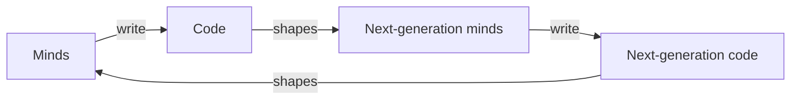

# The Recursive Loop

> *"Code shapes minds. Minds shape code. The code those minds write shapes the next generation of minds."*

---

## Overview

The Recursive Loop is Kenneth's most load-bearing idea — the concept that appears in more essays, informs more connections, and explains more of his worldview than any other single framework in the vault. It describes a feedback cycle operating at civilizational scale: programmers write code that shapes how people think, those shaped people write new code that shapes the next generation of thinkers, and the loop accelerates with each iteration. Every interface decision, every algorithm, every system deployed at scale is an act of consciousness architecture — whether the programmer knows it or not.

---

## The Mechanism

The loop operates on three levels, each feeding into the next.

At the personal level, code shapes the coder. Fifteen years of writing Python taught Kenneth to think in terms of readability, simplicity, and explicit rather than implicit communication. The Zen of Python became life philosophy — not through deliberate adoption but through the slow erosion of one way of thinking and its replacement by another. "Beautiful is better than ugly" started as a style guide and became an aesthetic stance. "There should be one obvious way to do it" started as API design and became a decision-making heuristic. The tool reshapes the hand that wields it.

At the collective level, code shapes everyone else. When Kenneth wrote [[requests]], he didn't just simplify HTTP in Python — he exported a design philosophy into the daily workflow of sixteen million machines. Every developer who writes `requests.get(url)` instead of wrestling with `urllib2` has their mental model of what software should feel like subtly recalibrated. Multiply that across every library, framework, and platform in existence, and you have code functioning as invisible infrastructure for collective cognition.

At the civilizational level, the loop becomes self-amplifying. The minds shaped by one generation's code write the next generation's code, which shapes the next generation of minds, which write the next generation of code. Each iteration compresses the cycle. Each iteration increases the surface area of influence. Social media algorithms didn't just change how people consume information — they changed how people think, which changed what kind of information gets produced, which changed the algorithms, which changed the thinking. The loop runs whether anyone is steering it.

The cycle, tightening with each generation it turns through:

---

## Why It Matters

Most programmers don't think of themselves as consciousness architects. They think of themselves as people solving technical problems. The Recursive Loop insists they're both, simultaneously, whether they like it or not. Every function that gets called a million times a day is a piece of cognitive infrastructure. Every default setting is a philosophical position exported at scale. Every algorithm that determines what people see is a value system wearing an engineering costume.

This isn't moral panic. It's structural observation. The recursive loop is neither good nor bad — it's a mechanism. [[requests]] makes HTTP simple and exports a design philosophy of human respect. An engagement-maximizing algorithm makes attention extraction simple and exports a design philosophy of human exploitation. Same loop. Different values. The mechanism doesn't care. The humans inside it should.

---

## Strange Loops and Hofstadter

The concept draws from Douglas Hofstadter's strange loops — self-referential systems where the output feeds back into the input, creating emergent properties that couldn't be predicted from the components alone. [[Strange Loops All the Way Down|Strange Loops All the Way Down]] traces this pattern through biology (DNA encoding the machinery that reads DNA), consciousness (awareness aware of itself), and code (programs that write programs that write programs). The Recursive Loop is a strange loop operating at the scale of human civilization, with programmers as the point where the loop becomes visible to itself.

---

## The Inversion

When the recursive loop inverts — when the feedback cycle produces the opposite of its intended effect — you get what Jung called [[Enantiodromia]]. Code written to connect people produces isolation. Algorithms designed to surface truth amplify lies. Systems built for liberation become instruments of control. The loop doesn't guarantee progress. It guarantees acceleration. What it accelerates depends on what values are encoded at each iteration.

The [[Algorithm Eats]] series documents enantiodromia at civilizational scale — engagement optimization consuming the very qualities (virtue, language, love, democracy, reality, time) it was nominally meant to serve. The loop eating itself.

---

## For Humans as Recursive Ethic

The [[For Humans]] philosophy is Kenneth's answer to the question the Recursive Loop raises: if code shapes consciousness, what should it be shaped toward? The answer is deceptively simple — toward the human on the other end. Sensible defaults. Readable interfaces. Respect for attention. The ethics of API design become the ethics of consciousness architecture. Make the common case easy. Make the human feel respected. Export that sensibility at scale and the loop carries it forward.

This is why Kenneth considers himself a designer disguised as a programmer. The design isn't just aesthetics. It's the values that propagate through the loop.

---

## Related

- [[The Recursive Loop How Code Shapes Minds|The Recursive Loop: How Code Shapes Minds]] — The foundational essay
- [[Strange Loops All the Way Down|Strange Loops All the Way Down]] — Recursive architecture across domains
- [[The Maintainer Is the Interface|The Maintainer Is the Interface]] — The programmer as the loop's inflection point
- [[Enantiodromia]] — When the loop inverts
- [[Algorithm Eats]] — The loop consuming what it was meant to serve
- [[For Humans]] — The ethic encoded in the loop
- [[requests]] — The loop in practice
- [[Consciousness]] — What the loop shapes
- [[AI Research]] — Domain index
- [[Design]] — Values propagated through craft

---

*"Every line of code is an act of consciousness architecture. The question is: whose consciousness, and toward what?"*

partOf:: [[Knowledge/AI/AI|AI]]
