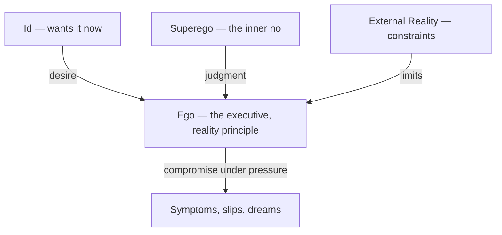

# The Id, Ego, and Superego

> *The eternal negotiation.*

Freud's structural model, introduced in *The Ego and the Id* (1923), divides the psyche into three agencies, each with its own agenda, locked in permanent conflict. It replaced neither the [[The Unconscious|topographic model]] nor the drives — it reorganized them around the problem of how the mind governs itself. The tension between the three produces anxiety. The compromises they strike produce personality. Freud's German terms were plainer than the Latinized translations suggest: *das Es* ("the It"), *das Ich* ("the I"), and *das Über-Ich* ("the Over-I") — not three homunculi but three forces pulling on a single self.

**The Id** wants what it wants. Present from birth, entirely unconscious, operating on the [[The Pleasure Principle|pleasure principle]] — immediate gratification, no morality, no logic, no sense of time or contradiction. It is a "cauldron full of seething excitations," the reservoir of libido and aggression in raw form. "Give me that. Now." Left to itself, the id would drive the organism to ruin, because it cannot tell a wish from a plan or a fantasy from a satisfaction.

**The Ego** is the executive. It develops out of the id in early childhood, forced into being by the collision between appetite and the world, and operates on the reality principle — "How can I get what I want without getting destroyed?" The ego is a servant with three masters: the id's demands, the superego's judgments, and external reality's constraints. It performs the reality-testing the id cannot, and it deploys [[Defense Mechanisms]] when the pressure gets too great. It is conscious, preconscious, and partially unconscious — much of its defensive work happens in the dark.

**The Superego** is the internalized parent, the heir to the Oedipus complex. Developing around age 5–7 as the child gives up its forbidden desires and takes in the parents' prohibitions, it contains both the conscience (guilt when you violate the rules) and the ego ideal (pride and self-worth when you meet them). It is often harsher than any real parent ever was, because it is built from the child's own aggression turned back inward. The superego doesn't care if you're happy — it cares if you're good, and it will punish transgressions committed only in thought.

The id says *more*. The superego says *no*. The ego says *later, and here's how*. When the ego can't reconcile the demands, anxiety spills over and it improvises compromises — symptoms, slips, dreams — each a treaty signed under duress. Neurosis, in this picture, is the ego losing the negotiation; therapy aims to strengthen its hand, which is what Freud meant by his terse program: "Where id was, there ego shall be."

The ego stands at the center of the negotiation, pressed on three sides and improvising the compromises.

---

## Related

- [[The Unconscious]] — Where the id lives
- [[Defense Mechanisms]] — The ego's toolkit
- [[The Shadow]] — Jung's parallel concept
- [[Major Freudian Concepts]] — Overview

partOf:: [[Knowledge/Psychology/Freudian/Freudian|Freudian]]
